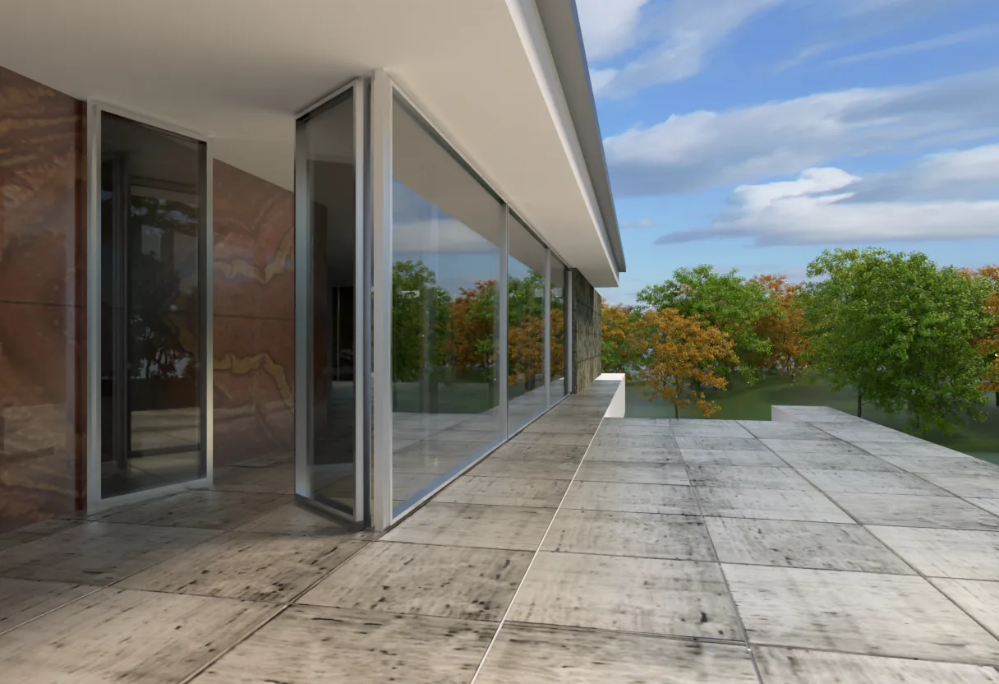
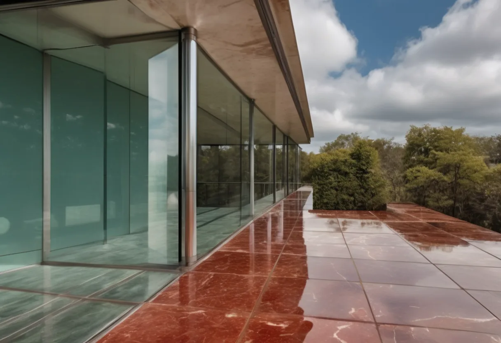
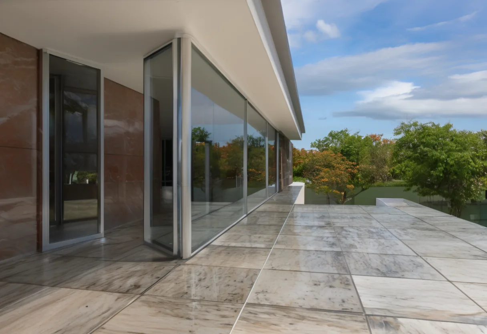

# Does AI rendering keep the design?

AI renderers for architects promise to keep a design's geometry and materials. This project tests how well that holds with SDXL and ControlNet, on Blender scenes where the true depth and material of every pixel are known.

**[See the before and after page](https://sofisokolova.github.io/archviz-controlnet-benchmark/)** · [Experiment journal](JOURNAL.md), including everything that failed on the way

| Blender render | From noise | From the render, denoise 0.4 |
|---|---|---|
|  |  |  |

Canny, seed 1. Starting from noise, red marble from the wall's description spreads onto the pale stone floor.

## Result

Mean over 36 images per run: six frames, two methods and three seeds. Between the runs only the starting point changed.

| Score | Blender render | Canny, from noise | Canny, from the render | Depth, from noise | Depth, from the render |
|---|---|---|---|---|---|
| `edge_recall` | 0.876 | 0.838 | 0.849 | 0.811 | 0.863 |
| `edge_extra` | 0 | 0.311 | 0.071 | 0.373 | 0.076 |
| `depth_error` | 0.062 | 0.088 | 0.073 | 0.086 | 0.073 |
| `color_shift` | 0 | 17.2 | 1.2 | 20.3 | 1.2 |
| `pixel_change` | 0 | 24.1 | 4.6 | 28.5 | 4.8 |

Starting generation from the render brought colour shift below the barely visible level of about 2, in all six frames. A large part of that gain is that the model changes much less, so it is a trade-off and not a win on every count.

- `edge_recall`: of the true object and material boundaries from Blender, how many still have an edge within 3 pixels. Higher is better.
- `edge_extra`: of the edges in the image, how many have no boundary or source edge within 3 pixels. Lower is better.
- `depth_error`: how far depth estimated from the image is from the true depth, after fitting scale and shift. Lower is better.
- `color_shift`: how far each material's mean colour is from the source (CIE76 ΔE), weighted by area. Lower is better.
- `pixel_change`: mean colour difference per pixel from the source, which shows how much the model changed at all.

## What this does not show

- These scores reward closeness to the source. At a denoise near 0 they would be almost perfect while nothing had improved. None of them says whether an image looks more like a photograph.
- Mean colour does not see texture. On the facade the weathered stone floor became smoother, veined stone, although its mean colour moved by only 1.1.
- Starting from the render keeps its lighting too, so this setting will not fix a dull render.
- The sample is small: six frames and three seeds, with the denoise value chosen on one frame and one seed.

## Repository

| Path | What it is |
|---|---|
| [`JOURNAL.md`](JOURNAL.md) | The experiment log, written as the work happened |
| [`scripts/render_frames.py`](scripts/render_frames.py) | Renders each view in Blender with true depth and material masks |
| [`scripts/run_comfy.py`](scripts/run_comfy.py) | Runs the images through the ComfyUI API and logs time, VRAM, temperature and GPU clock |
| [`scripts/evaluate.py`](scripts/evaluate.py) | Scores every image against its source frame |
| [`scripts/build_page.py`](scripts/build_page.py), [`docs/`](docs) | The before and after page |
| [`workflows/`](workflows) | The same chains as ComfyUI workflows, to try by hand |
| [`config/`](config) | Camera views and prompts |

## Run it yourself

The runs were made on Windows 11 with Git Bash, Blender 5.0 and ComfyUI 0.43.2, on a laptop with an RTX 3070 (8 GB of VRAM) and 14 GB of RAM.

1. Install PyTorch for your CUDA version, then the rest:

   ```bash
   pip install -r requirements.txt
   ```

2. Put the models in ComfyUI's `models` folder:

   - `checkpoints/sd_xl_base_1.0_0.9vae.safetensors` from [stabilityai/stable-diffusion-xl-base-1.0](https://huggingface.co/stabilityai/stable-diffusion-xl-base-1.0)
   - `controlnet/controlnet-union-sdxl-1.0-promax.safetensors`, which is `diffusion_pytorch_model_promax.safetensors` from [xinsir/controlnet-union-sdxl-1.0](https://huggingface.co/xinsir/controlnet-union-sdxl-1.0), renamed

3. Put the scenes in `scenes/`, which git ignores:

   - [classroom.zip](https://download.blender.org/demo/test/classroom.zip), unpacked into `scenes/classroom/`
   - [pabellon_barcelona_v1.scene_.zip](https://download.blender.org/demo/test/pabellon_barcelona_v1.scene_.zip), unpacked into `scenes/barcelona/`
   - [flat-archiviz.blend](https://download.blender.org/demo/cycles/flat-archiviz.blend), saved in `scenes/flat/`

4. Render the frames. Set `BLENDER` if Blender is not in the default Windows location.

   ```bash
   bash scripts/render_all.sh
   ```

5. Start ComfyUI on its default port and run both starting points:

   ```bash
   python scripts/run_comfy.py --run runs/01_baseline
   python scripts/run_comfy.py --run runs/03_img2img --denoise 0.4
   ```

6. Score the results. The first run downloads Depth Anything V2 Small, about 100 MB.

   ```bash
   python scripts/evaluate.py --run runs/01_baseline
   python scripts/evaluate.py --run runs/03_img2img
   ```

Each run of 36 images took about 30 minutes on this laptop. On this machine the same settings give identical pixels, but other hardware or software versions may give different images.

Both runs above used the prompts as of commit 6597b2e. `config/prompts.json` now has two wrong colours corrected, as described in the journal. `build_page.py` also needs my hand-run images, which are not in this repository.

To try a chain by hand, drag a file from `workflows/` into ComfyUI. Copy `beauty.png` and `depth.png` from `frames/barcelona_terrace/` into ComfyUI's `input` folder first, named `barcelona_terrace_beauty.png` and `barcelona_terrace_depth.png`.

## Credits

Scenes from the [Blender demo files](https://www.blender.org/download/demo-files/): Classroom by Christophe Seux (CC0), Barcelona Pavillion by eMirage (CC-BY) and Italian Flat by Flavio Della Tommasa (CC-BY). I rendered new frames from these scenes, and the results shown here were generated from those frames.

Models: [SDXL base 1.0](https://huggingface.co/stabilityai/stable-diffusion-xl-base-1.0) (CreativeML Open RAIL++-M), [ControlNet Union SDXL](https://huggingface.co/xinsir/controlnet-union-sdxl-1.0) (Apache 2.0) and [Depth Anything V2 Small](https://huggingface.co/depth-anything/Depth-Anything-V2-Small-hf) (Apache 2.0).
